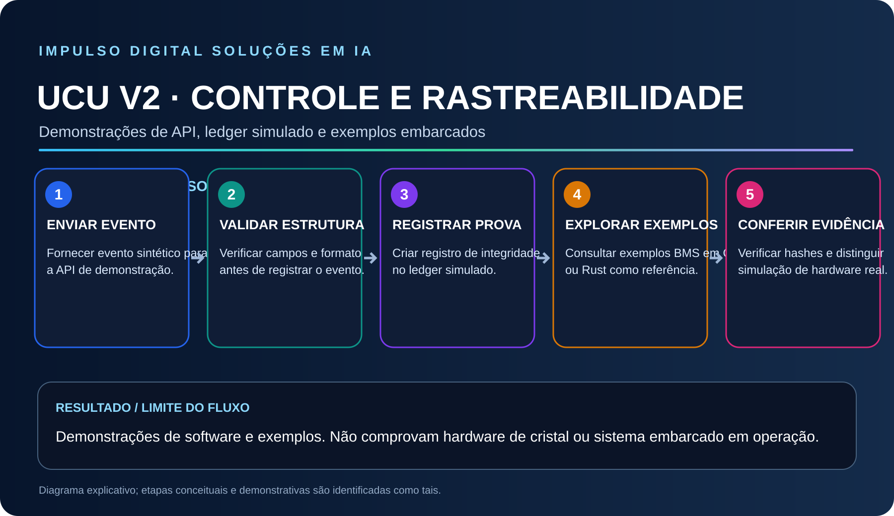
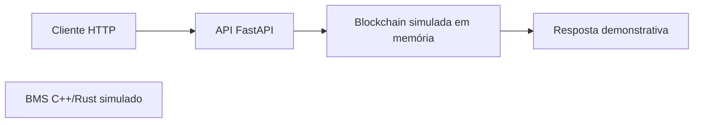

 | [](LICENSE) | [](https://github.com/sponsors/felipetjmg1-bit)

<p align="center"></p>


# UCU v2 — Demonstrações de Rastreabilidade e BMS

## Visão geral

Apesar do README de topo descrever uma infraestrutura de rastreabilidade DREX e soberania tecnológica, os artefatos públicos verificáveis são demonstrações separadas: um conector/API Python com blockchain em memória simulada, dois exemplos de firmware BMS que simulam leituras, e documentos/diagramas conceituais de hardware. O código consultado não implementa conexão efetiva a uma rede DREX/Aurora nem interface com hardware real.

## Objetivo e valor

**Problema/escopo:** Demonstrações de rastreabilidade com API Python e blockchain simulada, exemplos de BMS em C++/Rust e diagramas conceituais de hardware.

**Valor verificável hoje:** o repositório torna explícitos seus artefatos, interfaces e limitações para que mantenedores e contribuidores possam avaliar o que existe sem confundir demonstração, proposta e produção.

## Arquitetura e tecnologias

Arquitetura integrada não documentada. A árvore separa blockchain_integration (script Python e README), firmware/bms (fontes C++ e Rust e README) e hardware/schematics (texto, fonte D2 e imagem). A documentação de hardware descreve um conceito de barramento óptico/processador de quartzo; não demonstra integração funcional entre esse conceito, a API e o BMS.



- Python (linguagem detectada pelo GitHub): script com FastAPI e Pydantic; usa hashlib, datetime, json e typing da biblioteca padrão; a execução direta importa Uvicorn.
- C++: exemplo de BMS baseado em biblioteca padrão; leituras de sensores são simuladas.
- Rust: exemplo de BMS que importa rand; leituras são simuladas.
- D2: diagrama conceitual de hardware. O GitHub reporta Python, C++, Rust e D2; não há manifestos de dependências/build na árvore pública consultada.

## Início rápido

Os comandos abaixo refletem instruções, manifestos ou pontos de entrada presentes no repositório. Dependências externas, segredos e serviços estão indicados quando aplicável; a presença de um comando não equivale a uma execução validada.

1. O README de firmware documenta, a partir de firmware/bms: `g++ bms_firmware.cpp -o bms_firmware` e `./bms_firmware`. A fonte corresponde a um programa demonstrativo em C++; o comando não há execução validada registrada.
2. O README de integração documenta, a partir de blockchain_integration: `python3 drex_aurora_integration.py`. A fonte requer FastAPI e Pydantic e importa Uvicorn ao iniciar; não há manifesto nem instrução de instalação dessas dependências, portanto o comando isolado não é um quickstart reproduzível comprovado.
3. O README de firmware também descreve criar um projeto Cargo, copiar bms_firmware.rs para src/main.rs, adicionar rand = "0.8.5" e executar `cargo run`; isso não corresponde a um projeto Rust pronto no repositório, que não contém Cargo.toml. Não foi executado.


## Exemplo de uso

A API Python mantém uma cadeia simulada em memória. Após iniciar o servidor, crie uma transação, processe um bloco e consulte a verificação:

```bash
curl -X POST http://localhost:8000/transaction/new \
  -H 'Content-Type: application/json' \
  -d '{"component_id":"COMP-001","manufacturer":"Exemplo","location":"Curvelo","status":"produzido"}'
curl http://localhost:8000/mine
curl http://localhost:8000/drex/verify/COMP-001
```

Essas rotas demonstram somente o fluxo local em memória; não comprovam integração com uma rede DREX/Aurora nem comunicação com hardware.

## Estado e limitações

**Estado de entrega:** demonstrações de software e diagramas conceituais.

- O README de integração menciona a biblioteca `rand` como possível dependência Python, mas o script não usa rand/random: importa FastAPI e Pydantic e, no caminho de execução direta, Uvicorn. Isso torna a orientação de dependências incompleta/incorreta.
- O código de BMS descreve sensores e balanceamento, mas as leituras são geradas por simulação; comentários indicam que a lógica de carga/descarga está por implementar. Não apresentar como firmware validado para bateria ou hardware real.
- O código Python usa uma cadeia em memória e rotas locais; o endpoint de verificação busca nessa cadeia e devolve texto fixo de validação. A menção a redes DREX/Aurora no nome/comentários/README não comprova conexão ou validação externa.
- Os READMEs subordinados contêm instruções, mas nenhum comando, build, endpoint ou teste foi executado na revisão estática do repositório; ausência de manifestos e de workflow impede afirmar reprodutibilidade/CI.

## Contribuição

Leia [CONTRIBUTING.md](CONTRIBUTING.md) antes de abrir uma issue ou pull request. Para reportes de segurança, siga a orientação específica do repositório, se houver.

## Licença

Este repositório está licenciado sob **MIT**; consulte [LICENSE](LICENSE).

## Patrocínio e apoio

O desenvolvimento aberto exige tempo para manutenção, documentação, testes, revisão de contribuições e resposta a issues. Se este projeto for útil, considere apoiar a continuidade pelo [GitHub Sponsors](https://github.com/sponsors/felipetjmg1-bit). O apoio não representa promessa de funcionalidades, prazo de entrega ou suporte comercial.

[](https://github.com/sponsors/felipetjmg1-bit)


**Empresa responsável:** Impulso Digital Soluções em IA.
