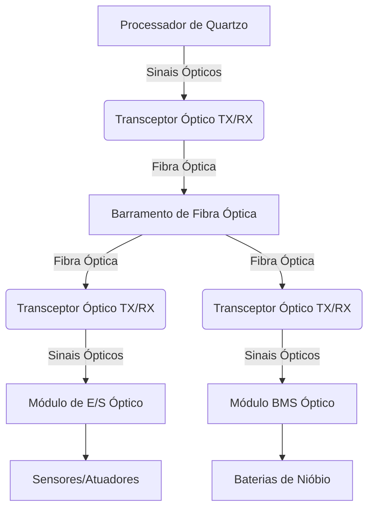
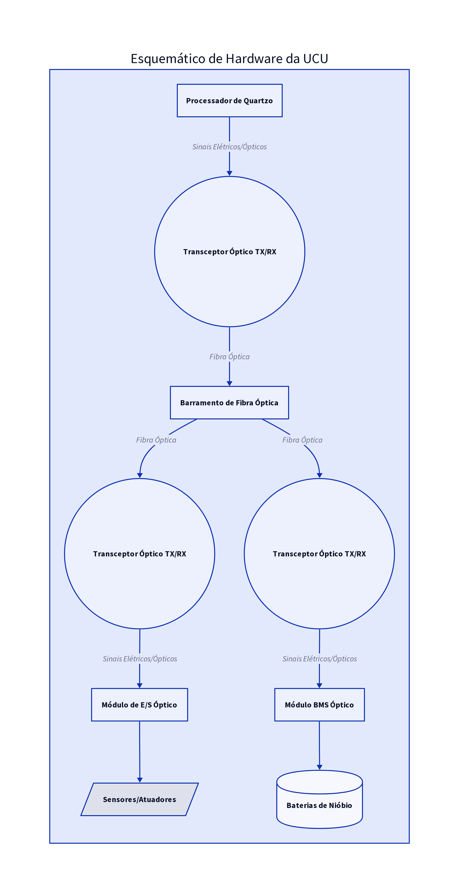

# Lógica de Barramento de Dados via Fibra Óptica e Arquitetura de Hardware

Este documento descreve a lógica de barramento de dados via fibra óptica integrada ao processador de quartzo para a Unidade de Controle de Cristal (UCU).

## Visão Geral da Arquitetura

A arquitetura de hardware da UCU é projetada para alta velocidade e imunidade a interferências eletromagnéticas, utilizando fibra óptica para a comunicação do barramento de dados. O processador central é baseado em quartzo, aproveitando suas propriedades para processamento fotônico.

## Componentes Chave

*   **Processador de Quartzo**: O coração da UCU, responsável pelo processamento de dados e controle. Ele possui interfaces ópticas integradas para comunicação direta com o barramento de fibra óptica.
*   **Transceptores Ópticos**: Módulos que convertem sinais elétricos em ópticos e vice-versa, permitindo a comunicação entre o processador e o barramento de fibra.
*   **Barramento de Fibra Óptica**: Uma rede de fibras ópticas que interconecta os diversos módulos da UCU, garantindo alta largura de banda e baixa latência.
*   **Módulos de E/S Ópticos**: Interfaces para conectar sensores, atuadores e outros periféricos ao barramento de fibra óptica.

## Lógica do Barramento de Dados

O barramento de dados opera com um protocolo de comunicação proprietário otimizado para transmissão óptica. As principais características incluem:

*   **Transmissão Assíncrona/Síncrona**: Suporte para ambos os modos de transmissão, dependendo da criticidade e volume dos dados.
*   **Multiplexação por Divisão de Tempo (TDM)**: Para otimizar o uso da largura de banda da fibra, diferentes fluxos de dados podem ser multiplexados no tempo.
*   **Correção de Erros (FEC)**: Implementação de algoritmos de correção de erros para garantir a integridade dos dados transmitidos em ambientes ruidosos.
*   **Priorização de Dados**: Mecanismos para priorizar dados críticos, como informações de segurança do BMS, sobre dados menos urgentes.

## Diagrama de Blocos (Conceitual)

## Esquema de Hardware (Placeholder)

Um arquivo `ucu_hardware_schematic.d2` será gerado com o esquema detalhado do hardware, incluindo pinagens, componentes e interconexões físicas. Este arquivo será o principal artefato para a fabricação e montagem da UCU.

## Esquema de Hardware (Diagrama)

Abaixo está o diagrama conceitual do esquema de hardware da UCU, gerado a partir do arquivo D2.

